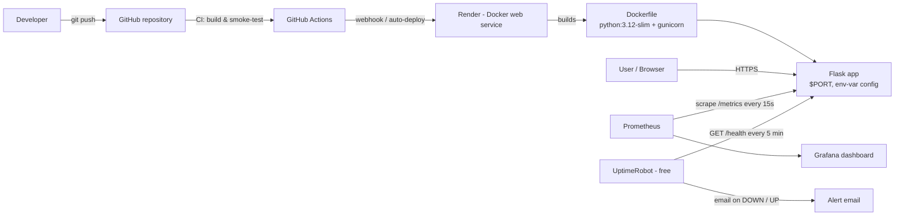

# Task 06 — Cloud Infrastructure Deployment & Monitoring Capstone

**RabTech Academy Internship · Cloud Computing & DevOps · Suraj Dhakad**

A small Flask service, containerised with Docker, deployed to a cloud
platform (Render), configured entirely through environment variables, and
monitored with Prometheus metrics, health checks and external uptime
alerts.

---

## Live endpoint

> **Live cloud application URL:** _to be filled in after deployment_
>
> - Service info: `<LIVE_URL>/`
> - Health check: `<LIVE_URL>/health`
> - Metrics: `<LIVE_URL>/metrics`

---

## Architecture



In words: code lives in GitHub. A push triggers CI, which builds the
Docker image and smoke-tests it; Render pulls the same repository, builds
the `Dockerfile`, injects environment variables and runs the container
behind its HTTPS endpoint. Prometheus scrapes `/metrics`; an external
uptime checker probes `/health` and emails on failure.

## The application

[`app.py`](app.py) — Flask, no external services, configuration from
environment variables only:

| Variable   | Default            | Meaning              |
|------------|--------------------|----------------------|
| `APP_NAME` | `rabtech-capstone` | Service name shown at `/` |
| `APP_ENV`  | `development`      | Environment label (`production` on Render, set in `render.yaml`) |
| `PORT`     | `8000`             | Listen port (provided by Render at runtime) |

| Endpoint   | Response |
|------------|----------|
| `GET /`        | Service info JSON (name, environment, version, status) |
| `GET /health`  | `{"status": "ok"}` — used by Docker HEALTHCHECK, Render and the uptime monitor |
| `GET /metrics` | Prometheus format: `http_requests_total` counter (method/endpoint/status) + `process_uptime_seconds` gauge |

## End-to-end deployment pipeline

```
1. CODE      Developer pushes to GitHub (main branch).
2. CI        GitHub Actions checks out the repo, builds the Docker image
             and smoke-tests it (curl /health inside the build job) —
             a broken image never reaches the platform.
3. DEPLOY    Render detects the push (autoDeploy: true in render.yaml),
             rebuilds from the Dockerfile and starts the new container.
4. CONFIG    Render injects environment variables (APP_NAME, APP_ENV,
             PORT) — automated env-var configuration, zero code edits,
             zero secrets in the repository.
5. VERIFY    Render polls healthCheckPath /health; the deploy only goes
             live once it returns HTTP 200. Docker's own HEALTHCHECK
             keeps watching the container afterwards.
6. MONITOR   Prometheus scrapes /metrics (alert rules for downtime),
             Grafana visualises traffic and uptime, and UptimeRobot
             probes the public /health URL every 5 minutes with email
             alerts. See monitoring/README-monitoring.md.
```

## How to deploy (Render)

**Option A — Blueprint (recommended, uses `render.yaml`):**

1. Push this repository to GitHub.
2. Render Dashboard → **New → Blueprint** → connect the repository.
3. Render reads `render.yaml`, creates the free Docker web service
   `rabtech-capstone` with `healthCheckPath: /health` and the env vars
   `APP_NAME` / `APP_ENV` pre-filled → **Apply**.
4. Wait for the first deploy to go **Live**, then paste the
   `https://….onrender.com` URL into the *Live endpoint* section above.

**Option B — Manual web service:**

1. Render Dashboard → **New → Web Service** → connect the repo.
2. Environment: **Docker**, Plan: **Free**, Dockerfile path `./Dockerfile`.
3. Health Check Path: `/health`.
4. Add environment variables `APP_NAME=rabtech-capstone`,
   `APP_ENV=production` → **Create Web Service**.

**Local run (identical container):**

```bash
docker build -t rabtech-capstone .
docker run -p 8000:8000 -e APP_ENV=local rabtech-capstone
curl http://localhost:8000/health     # {"status":"ok"}
curl http://localhost:8000/metrics    # Prometheus exposition
```

Or without Docker: `pip install -r requirements.txt && python app.py`.

## Repository layout

| Path | Purpose |
|------|---------|
| `app.py` | The Flask service (`/`, `/health`, `/metrics`) |
| `requirements.txt` | `flask`, `gunicorn` |
| `Dockerfile` | Slim image, non-root user, `HEALTHCHECK`, gunicorn on `$PORT` |
| `render.yaml` | Render Blueprint: free Docker web service + env vars + health check |
| `monitoring/prometheus.yml` | Prometheus scrape config for `/metrics` |
| `monitoring/alert-rules.yml` | `ServiceDown` / `MetricsMissing` alert rules |
| `monitoring/README-monitoring.md` | Prometheus + Grafana + uptime-checker guide |

## Notes

- Free Render services spin down after ~15 minutes without traffic; the
  first request afterwards has a cold start of roughly 30–60 seconds.
  The uptime checker's 5-minute probes also help keep an eye on this.
- No secrets are stored in this repository — all configuration arrives
  via environment variables at deploy time.
